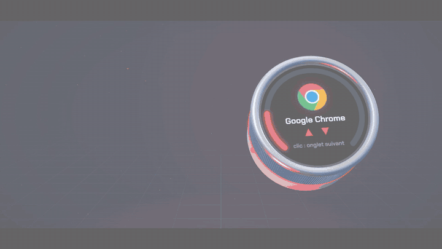
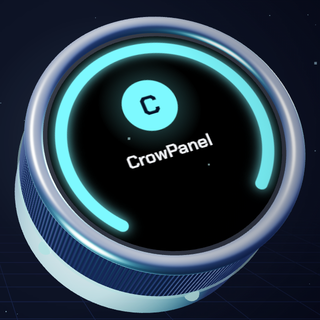
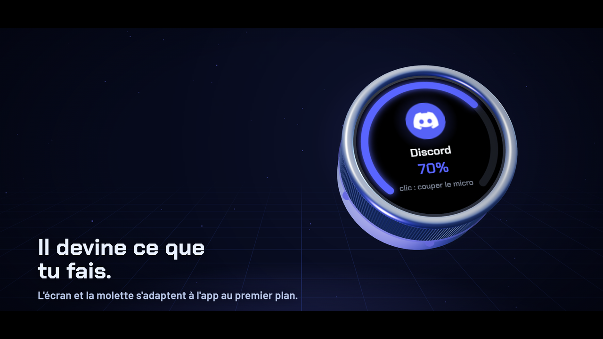

<div align="center">

# CrowPanel Knob

**Une molette. Toutes tes apps.**

Un macro-pad rond pour PC Windows : l'écran et la molette s'adaptent à l'application au premier plan,
affichent ta musique, ton imprimante 3D, tes alertes… et laissent même Claude Code te demander la permission.

[](docs/trailer.mp4)

▶ **[Voir le trailer complet (46 s, 1080p)](docs/trailer.mp4)**

</div>

> 🤖 **Projet développé avec Claude.** Tout le code de ce dépôt — firmware ESP32, compagnon Windows,
> éditeur 3D, supports imprimables, trailer et sa musique — a été écrit par **Claude** (Anthropic), dans
> [Claude Code](https://claude.com/claude-code), au fil d'une conversation avec son auteur. Voir
> [Comment ce projet a été fait](#-comment-ce-projet-a-été-fait).

*English summary below — [jump to English](#-english-summary).*

---

## 🛒 Le matériel à acheter

| | Produit | Indispensable ? |
|---|---|---|
|  | **[Elecrow CrowPanel 1.28" HMI ESP32-S3 Rotary Display](https://www.elecrow.com/crowpanel-1-28inch-hmi-esp32-rotary-display-240-240-ips-round-touch-knob-screen.html)** — écran IPS rond tactile 240×240, molette crantée cliquable, 5 LEDs RGB, ESP32-S3 (16 Mo de flash, 8 Mo de PSRAM). Le câble USB fourni suffit. | **Oui** — c'est le seul achat obligatoire |
| | Un **PC Windows 10/11** avec Python 3.12+ | **Oui** |
| | Une imprimante 3D + visserie M3/M4/M5/M6 (détails dans les README des supports) | Non — pour fixer le module (et un Pixel Fold) sur un clavier **Keychron K10 Max** |
| | Une imprimante **Bambu Lab** en réseau local | Non — pour le widget d'impression et la caméra |
| | Des lampes **Philips Hue** | Non — pour la tuile Hue |

> Le rendu ci-dessus est le modèle 3D du projet ; les photos officielles et le prix sont sur la
> [page du produit chez Elecrow](https://www.elecrow.com/crowpanel-1-28inch-hmi-esp32-rotary-display-240-240-ips-round-touch-knob-screen.html).

---

## ✨ Ce que ça fait



**L'écran suit la fenêtre active** — vraie icône de l'app, couleur d'accent tirée de l'icône, LEDs qui
respirent dans cette couleur — et la molette fait ce qu'il faut selon l'app :

| App | Tourner | Clic | Appui long |
|---|---|---|---|
| Spotify, VLC | piste suivante / précédente | lecture / pause | **mode dédié** (verrouillé, visualiseur audio) |
| Chrome, Edge, Firefox | défilement | onglet suivant | onglet précédent |
| Discord | volume de Discord | couper le micro | couper Discord |
| Telegram, WhatsApp | conversation suivante / précédente | Échap | — |
| Outlook | message suivant / précédent | marquer comme lu | répondre |
| Windows Terminal | flèches ↑ ↓ | Entrée | Échap |
| Bambu Studio | zoom | trancher | caméra de l'imprimante |
| … | entièrement configurable dans l'éditeur | | |

### Tuiles (on glisse vers la gauche)
- **Volume** — volume réel de Windows, nom de la sortie active ; appui long : choix de la sortie audio
  (compatible **SteelSeries Sonar**) ; glisser haut/bas : piste suivante/précédente, double tap : lecture/pause.
- **Tableau de bord** — horloge, météo, prochain rendez-vous Outlook, impression en cours ; clic : historique des alertes.
- **Réseau** — débits montant/descendant en direct avec historique.
- **Système** — CPU, GPU NVIDIA, RAM, température GPU.
- **Hue** — luminosité et couleur réelle de chaque pièce.

### Widgets et automatismes
- 🎵 **Mode dédié média** : pochette ronde, spectre audio de 48 barres en direct (capture du son du PC), titre défilant, LEDs qui battent sur les basses.
- 🖨️ **Bambu Lab** : progression, temps restant, couches, caméra en direct dans l'anneau, alertes de fin / pause / échec.
- 🤖 **Claude Code** : statut des sessions (au travail / attend ta réponse / terminé) et **réponse aux demandes de permission à la molette** (OUI / TOUJOURS / NON / TERMINAL), sans quitter ce que tu fais.
- 🔔 **Alertes** plein écran par-dessus tout, rangées dans un historique.
- 🎙️ **Mode réunion** : badge « micro ouvert / coupé » dès qu'une app utilise le micro, alertes en silencieux.
- 🌙 **Veille et mode nuit**, 🔇 **coupure du son après 10 min d'absence** (rétabli à ton retour).
- 🎯 **Lanceur radial** (appui long sur l'écran) avec les vraies icônes de tes apps.

### L'éditeur 3D
Triple clic sur la molette (ou double-clic sur l'icône de la barre des tâches) : une console holographique
s'ouvre dans le navigateur, avec le module en 3D dont l'écran affiche le rendu réel de chaque profil.


### Les supports imprimables
| Keychron K10 Max — coin droit, module à 70° | Keychron K10 Max — coin gauche, Pixel 10 Pro Fold déplié |
|---|---|
|  |  |
| [`mount/`](mount/) | [`mount_pixel/`](mount_pixel/) — cadre à glissière, pivot à friction |

---

## 🚀 Installation

### 1. Firmware (une fois)
Avec [PlatformIO](https://platformio.org/) :
```powershell
cd knob/firmware
pio run -t upload        # adapter upload_port dans platformio.ini (port COM du module)
```
Les mises à jour suivantes se font en un clic depuis l'éditeur ou l'icône de la barre des tâches.

### 2. Compagnon PC
```powershell
cd knob/pc
python -m venv .venv
.venv\Scripts\python -m pip install -r requirements.txt
.venv\Scripts\pythonw knob_companion.py
```
Pour le lancer au démarrage : un raccourci vers `.venv\Scripts\pythonw.exe knob_companion.py` dans `shell:startup`.
`ffmpeg` (dans le PATH) est nécessaire seulement pour la caméra Bambu.

### 3. Statut et permissions Claude Code (optionnel)
Dans `~/.claude/settings.json` :
- `knob/pc/claude_hook.py` (asynchrone) sur `UserPromptSubmit`, `PreToolUse`, `PostToolUse`,
  `PostToolUseFailure`, `PermissionRequest`, `Notification`, `Stop`, `SessionEnd` ;
- `knob/pc/claude_permission.py` (synchrone, `timeout` 200) sur `PermissionRequest`.

Le hook de permission vérifie d'abord que le compagnon répond ; sinon le dialogue normal du terminal s'affiche.

### 4. Réglages
Tout se règle dans l'éditeur : **http://127.0.0.1:47615/** (local uniquement).

---

## 🧱 Architecture

```
knob/firmware/   ESP32-S3, Arduino + LVGL 8.3 — écran GC9A01, tactile CST816D, molette sur interruptions,
                 USB composite (clavier multimédia HID + série) avec un PID dédié
knob/pc/         Compagnon Windows (Python) — fenêtre active, icônes, profils, widgets (média GSMTC,
                 Bambu MQTT local, Hue, Outlook, météo), serveur local + éditeur 3D (Three.js)
knob/trailer/    Le trailer : scène Three.js rendue image par image + musique générée par code
mount/, mount_pixel/   Supports OpenSCAD paramétriques + STL prêts à imprimer
```
Le module et le PC parlent un protocole texte simple sur le port série USB (documenté en tête de
[`knob/firmware/src/main.cpp`](knob/firmware/src/main.cpp)). Sans PC, le module reste un bouton de volume USB autonome.

---

## 🤖 Comment ce projet a été fait

Ce projet est né d'une question simple : *« J'ai acheté ce module, qu'est-ce que je pourrais faire de stylé avec ? »*
Il a ensuite été construit **entièrement par Claude** (modèle Claude Opus, dans Claude Code), en conversation :

- **L'humain** a apporté les idées, les priorités, les retours (« ça ne fonctionne pas », « ce n'est pas fluide »)
  et les tests sur le vrai matériel, posé sur son vrai clavier.
- **Claude** a écrit tout le code et tous les fichiers : firmware, compagnon, hooks, éditeur 3D, modèles
  OpenSCAD, scène et musique du trailer — et a fait le travail d'ingénierie autour : lire la documentation
  du matériel, sonder les API (SteelSeries Sonar, Bambu Lab, Windows), mesurer les performances du rendu
  sur le module pour trouver les goulots, flasher, tester et corriger.

Quelques exemples de problèmes résolus en route : le module bloqué en mode flash après une mise à jour
(drapeau `FORCE_DOWNLOAD_BOOT` à effacer), le port série muet sans DTR, la sortie audio qui ne changeait pas
à cause de Sonar, ou le visualiseur passé de 9 à 30 images/s après avoir mesuré chaque étape du rendu LVGL.

---

## 🌍 English summary

**CrowPanel Knob** turns the [Elecrow CrowPanel 1.28" ESP32-S3 Rotary Display](https://www.elecrow.com/crowpanel-1-28inch-hmi-esp32-rotary-display-240-240-ips-round-touch-knob-screen.html)
(the only required purchase) into a context-aware macro pad for Windows: the round screen and the knob adapt
to the foreground app (real app icon and colour, per-app knob/click/long-press actions), with tiles for volume,
dashboard, network, system and Philips Hue, a Spotify "dedicated mode" with a live audio visualizer, Bambu Lab
printer status and camera, alerts, meeting and night modes — and Claude Code permission prompts you can answer
with the knob. Configuration happens in a 3D browser editor. Printable mounts for a Keychron K10 Max are included.

**This whole project was built with Claude** (Anthropic) in Claude Code: the human provided ideas, feedback
and real-hardware testing; Claude wrote all the code, the 3D models, the trailer and its music.
The UI and docs are in French. License: MIT.

---

<div align="center">

Licence [MIT](LICENSE) · Three.js (MIT) servi en local · police Chakra Petch / Barlow (Google Fonts, OFL)<br>
CrowPanel est une marque d'Elecrow ; ce projet n'est pas affilié à Elecrow, Keychron, Bambu Lab, Signify (Hue) ou SteelSeries.

</div>
