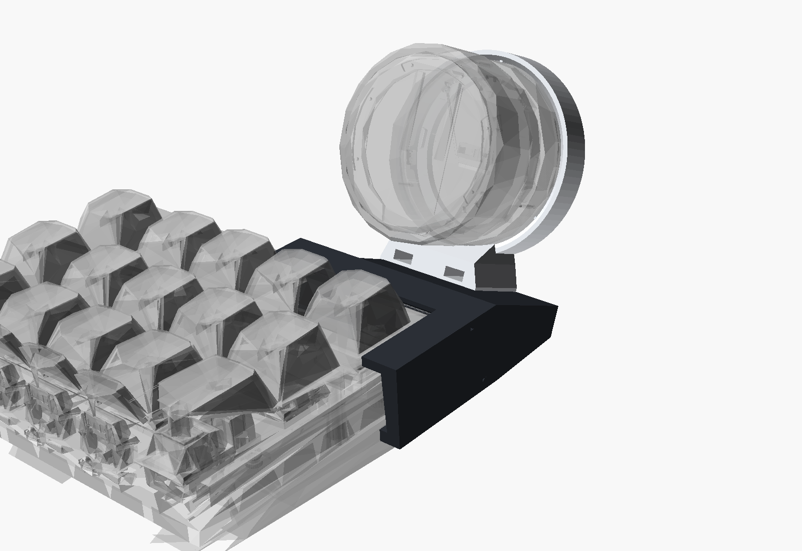

# Support CrowPanel 1.28" pour Keychron K10 Max

Le support se pince sur le **coin arrière droit** du K10 Max, sans perçage ni colle. Il tient le CrowPanel par son **socle acrylique fixe** : la molette moletée reste libre de tourner et de s'enfoncer, et la lumière des LEDs reste visible. L'écran fait **70°** avec le bureau, tourné vers toi, et son bord bas est juste au-dessus des keycaps arrière.



## Fichiers

| Fichier | Rôle |
|---|---|
| `crowpanel_k10_mount.scad` | Modèle paramétrique OpenSCAD (tous les réglages sont en haut du fichier) |
| `crowpanel_k10_clip_print.stl` | **Pince + tour**, déjà orientée pour l'impression (couchée sur la joue droite) |
| `crowpanel_k10_cradle_print.stl` | **Berceau** du CrowPanel, déjà orienté (anneau d'appui sur le plateau) |
| `crowpanel_k10_fit_test.stl` | Tranche de 12 mm de la pince, pour **valider l'accroche avant la grande impression** (~10 min) |
| `preview_*.png` | Aperçus : `preview_assembly.png`, `preview_user_view.png` (vue depuis ta place), `preview_side.png`, `preview_print.png` |
| `checks/` | Coupes de contrôle : pièces comparées aux CAO officielles Keychron et Elecrow |
| `ref/`, `tools/` | CAO de référence (Keychron K10 Max, CrowPanel Elecrow) et scripts de conversion et de contrôle |

## Matériel
- 2 vis **M3x10** (tête cylindrique) et 2 écrous **M3**
- Les écrous se glissent par le haut de la semelle du berceau. Les vis passent par en dessous, dans la tour.

## Avant d'imprimer : 4 mesures au pied à coulisse
Les cotes viennent de la CAO officielle Keychron, mais le clavier réel peut différer de quelques dixièmes.

1. **`rim_h` = 14.25** : hauteur de la paroi du boîtier supérieur, du dessus du rebord arrière jusqu'à la petite marche où commence le boîtier inférieur (en retrait d'environ 2,7 mm).
2. **`ledge` = 2.7** : profondeur de cette marche. Le crochet avance de `hook_d` = 1.9 dessous.
3. **`rear_h` = 29.8** : hauteur entre le bureau et le dessus du rebord arrière, pieds rabattus. Si tu déplies les pieds, mets cette mesure à jour, ainsi que `typing_deg`.
4. **`rim_rear_w` / `rim_side_w`** : largeur du rebord libre entre le bord et les keycaps (≈ 10 mm derrière, ≈ 9 mm à droite). Les lèvres de la pince n'en couvrent que 6 mm (`lip_w`).

**Imprime d'abord `fit_test`** et clipse-le sur le bord arrière. S'il flotte, baisse `fit` (0.25 → 0.1). S'il force trop, monte-le à 0.35. Ensuite, régénère les STL.

## Impression
- **Matériau** : PETG de préférence (un peu de souplesse pour la pince), le PLA fonctionne aussi.
- **Couches** 0,2 mm, **4 périmètres**, **remplissage 30 %** (gyroïde), **sans supports** pour les deux pièces.
- **Pince** : imprime-la telle qu'elle est dans le STL, joue droite sur le plateau, sans supports. Les lèvres et le crochet sont ainsi dans le sens des couches, ce qui les rend solides en flexion.
- **Berceau** : anneau d'appui sur le plateau. Les nervures intérieures assurent le serrage.

## Montage
1. Glisse les 2 écrous M3 dans les fentes du berceau, puis visse le berceau sur la tour (vis par en dessous).
2. Enfonce le **socle** du CrowPanel dans le berceau : le connecteur et le câble passent par l'ouverture du fond, et BOOT/RESET restent accessibles.
3. Pousse la pince **d'arrière en avant** sur le coin du clavier. La lèvre glisse sur le rebord, le crochet passe sous la marche et la joue s'appuie sur le flanc droit.
4. Fais descendre le câble USB derrière le clavier.

## Réglages utiles (en haut du `.scad`)
- `tilt_deg` (70) : inclinaison de l'écran.
- `screen_low_z` (42) / `screen_low_y` (0) : hauteur et recul du bord bas de la molette.
- `cp_x` (−24) : position latérale de l'écran par rapport au bord droit.
- `cup_fit` / `rib_h` : serrage du socle. Si le socle tourne avec la molette, baisse `cup_fit` à 0.1.
- `clip_len`, `side_len` : longueur de la pince le long des bords.

Pour régénérer les STL :
```
openscad -o crowpanel_k10_clip_print.stl   -D 'part="clip_print"'   crowpanel_k10_mount.scad
openscad -o crowpanel_k10_cradle_print.stl -D 'part="cradle_print"' crowpanel_k10_mount.scad
openscad -o crowpanel_k10_fit_test.stl     -D 'part="fit_test"'     crowpanel_k10_mount.scad
```
