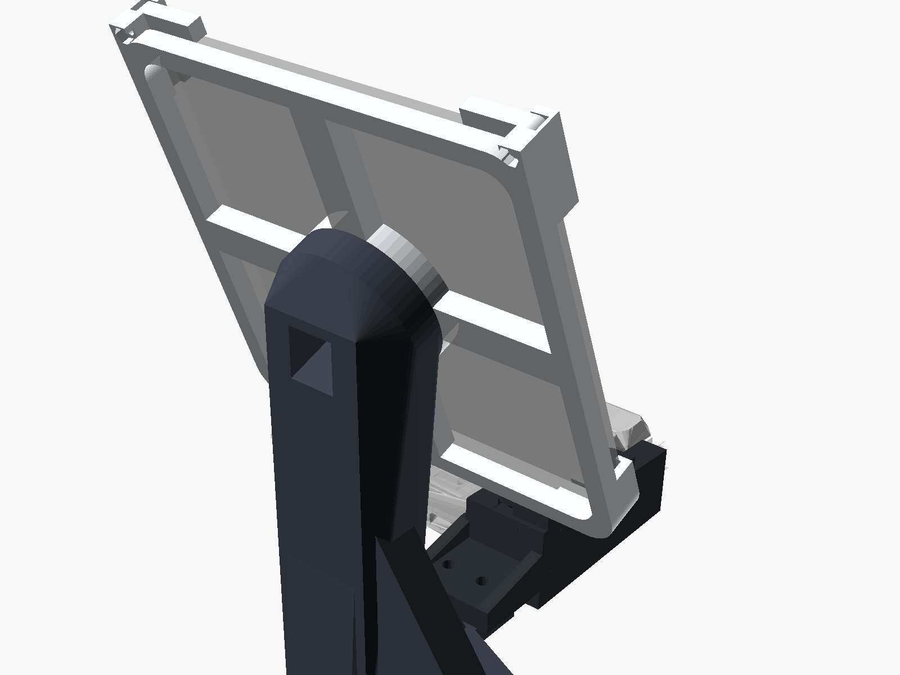
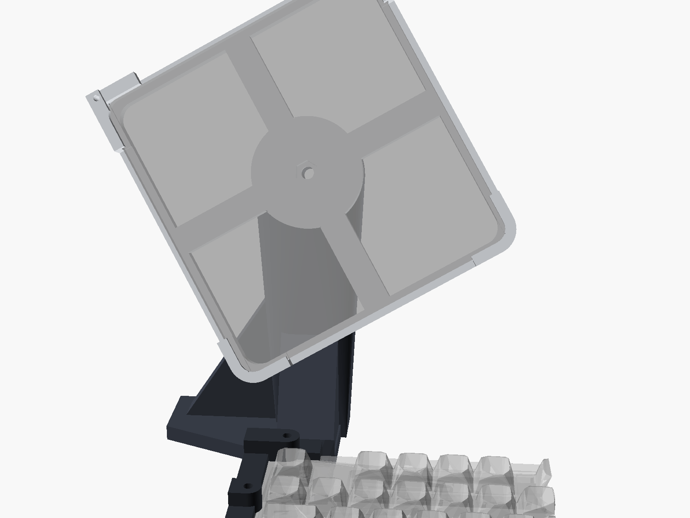
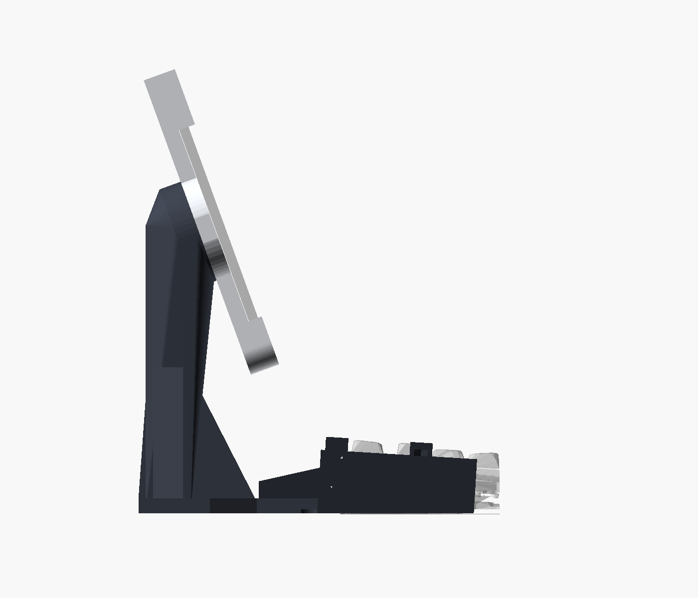
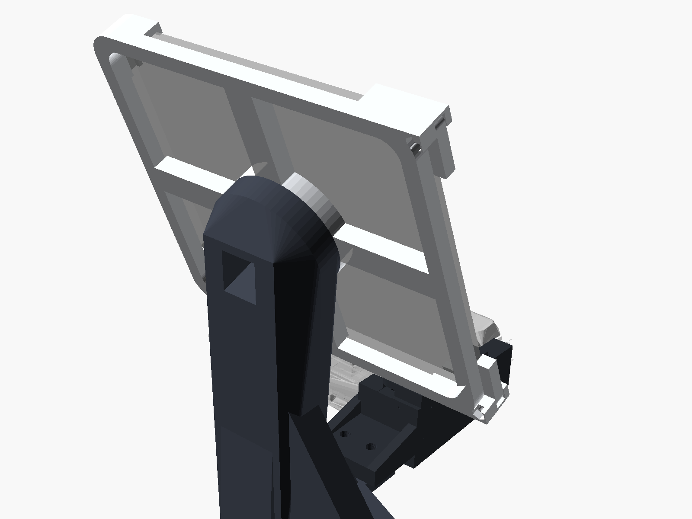

# Support rotatif Pixel 10 Pro Fold (déplié) pour Keychron K10 Max

Le support se fixe sur le **coin arrière gauche** du K10 Max. Le téléphone **ouvert** glisse dans un **cadre** qui **tourne librement** autour de son centre (portrait, paysage ou n'importe quel angle). Une friction réglable lui fait garder sa position. L'écran est incliné à **70°** vers toi, derrière le clavier, et rien ne passe au-dessus des touches.

| | |
|---|---|
|  |  |
|  |  |

## Principe anti-« branle »
1. **Le poids repose sur le bureau.** La colonne vient d'un **socle posé à plat** derrière le clavier (5 patins caoutchouc, semelle élargie vers la gauche jusqu'à X = −60 mm). La pince ne porte presque rien : elle rend le socle solidaire du clavier.
2. **Pince serrée sans jeu.** La pince en C (lèvre sur le rebord, crochet sous la marche, sur l'arrière et sur le flanc gauche) est **serrée par 2 vis molettées M4**. Elles appuient sur le rebord et plaquent les crochets sous la marche : plus aucun jeu vertical, et la friction bloque le glissement.
3. **Pivot plan à grand diamètre.** Le disque du cadre (Ø56) est serré contre la tête de colonne par un **boulon M6, une rondelle élastique et un écrou nylstop**. Cette grande surface plane empêche le cadre de basculer, et le serrage règle la friction de rotation.
4. **Liaison pince ↔ socle par 2 vis M5** sur un recouvrement de 30 × 39 mm, renforcée par des goussets.

### Ordres de grandeur
- Masse sur le pivot : téléphone 258 g + cadre ≈ 60 g, soit **≈ 0,32 kg (3,1 N)**, à 154 mm du bureau. Le pivot est 24 mm devant l'axe de la colonne : moment statique ≈ 0,08 N·m, négligeable devant l'assise du socle (100 mm de profondeur).
- Coup sec sur le clavier (5 m/s² latéral) : 1,6 N au pivot, soit 0,25 N·m en pied de colonne. Section de la colonne 38 × 24 mm (I ≈ 1,1·10⁵ mm⁴ latéral, 4,4·10⁴ mm⁴ avant-arrière). Flèche calculée ≈ 0,02 mm et contrainte ≈ 0,05 MPa : la colonne est très largement surdimensionnée. Ce qui pourrait bouger, ce sont les liaisons, d'où le serrage par vis partout.
- Friction du pivot : avec ≈ 150 N de serrage (¼ de tour après contact, rondelle élastique comprimée), le couple de friction est d'environ 1 N·m. C'est 30 fois le couple d'un câble USB qui tire sur un coin, et ça reste tournable à la main (≈ 10 N au coin du cadre). Le téléphone est centré sur le pivot, donc son poids ne fait pas tourner le cadre.

## Pièces (`stl/`, déjà orientées pour l'impression)
| Fichier | Qté | Pièce | Orientation |
|---|---|---|---|
| `pixel_k10_test_accroche.stl` | 1 | Tranche de 9 mm du profil de la pince (≈ 10 min) | À plat |
| `pixel_k10_P1_pince.stl` | 1 | Pince en C + patte arrière | Couchée sur la joue gauche |
| `pixel_k10_P2_socle.stl` | 1 | Semelle + colonne + tête de pivot (176 mm de haut) | Debout sur la semelle |
| `pixel_k10_P3_cadre.stl` | 1 | Cadre du téléphone (158 × 167 mm) | Dos sur le plateau |
| `pixel_k10_P4_loquet_x2.stl` | **2** | Loquets pivotants du haut du cadre | À plat |
| `pixel_k10_P5_molette_x2.stl` | **2** | Molettes des vis de serrage | À plat |

Tout passe sur un plateau de 256 × 256 mm (X1 / P1 / H2D). Aucun support n'est nécessaire. Seules les lèvres avant du cadre (2,2 mm) et le dessus du tunnel de clé (en losange) sont de légers porte-à-faux, que le PETG imprime sans problème.

## Visserie
- **1 × M6 × 30** (tête H), 2 rondelles M6, **1 rondelle élastique** (Grower ou rondelle ressort), **1 écrou M6 nylstop**. La tête du boulon est noyée dans le disque du cadre, sous le téléphone.
- **2 × M5 × 16** (tête cylindrique ou H) + 2 écrous M5 : pince ↔ socle (écrous logés sous la semelle).
- **2 × M4 × 20** (tête H) + 2 écrous M4 : vis de serrage, avec la tête collée ou pressée dans les molettes P5.
- **2 × M3 × 16** + 2 écrous M3 : axes des loquets (écrous au dos du cadre).
- **5 patins adhésifs Ø12 × 3 mm** sous la semelle (logements de 2 mm de profondeur), plus **2 pastilles de feutre Ø6** sous la pointe des vis M4 pour ne pas marquer le rebord. Optionnel : une bande de feutre de 1 mm sous la joue gauche.

## Avant d'imprimer : mesures au pied à coulisse
Les cotes viennent de la CAO officielle Keychron. Celles du téléphone viennent de la fiche Google : 155,2 × 150,4 × 5,2 mm déplié, 258 g ([GSMArena](https://www.gsmarena.com/google_pixel_10_pro_fold-14014.php)).

**Clavier :**
1. `rear_h` = 29.8 : bureau → dessus du rebord arrière, pieds **rabattus**. Si tu utilises les pieds dépliés, mesure et mets à jour `rear_h` et `typing_deg`.
2. `rim_h` = 14.25 : du dessus du rebord jusqu'à la petite marche sous laquelle se glisse le crochet. `ledge` = 2.7 : profondeur de cette marche.
3. `rim_rear_w` = 10.6 et `rim_side_w` = 9.7 : rebord libre entre le bord et les keycaps (Échap). Les lèvres n'en couvrent que 6,5 mm.
4. `ports_x0` = 35 : le panneau USB-C + interrupteurs commence à 35 mm de la face gauche. La pince s'arrête à 31 mm et la patte à 34 mm, pour que le câble du clavier reste branchable.

**Téléphone :**
5. `ph_r` = 9 : **rayon des coins** du téléphone déplié (estimé). Mesure-le, ou mets 10 si les coins du cadre forcent.
6. **Boutons et port :** le cadre ne tient le téléphone que par ses **4 coins** (`leg` = 24 mm sur chaque bord). Le milieu de chaque bord reste libre pour le port USB-C (fiche droite ou coudée, dans n'importe quelle orientation) et pour les boutons. Si un bouton tombe dans les 24 mm d'un coin, baisse `leg` (par exemple 16).
7. **Îlot photo :** le dos du téléphone ne repose que sur la croix centrale (charnière + milieu de chaque moitié, 14 mm de large) et sur 4 mm du bord dans les coins (`ledge_in`). Vérifie que l'îlot photo ne tombe sur aucun de ces appuis.
8. **Coque :** sans coque, `gap` = 0.5 et `t_gap` = 0.5. Avec une coque fine, ajoute son épaisseur à `ph_t` et augmente `gap`.

**Imprime d'abord `test_accroche`** et clipse-le sur le bord arrière du clavier. S'il flotte, baisse `fit` (0.25 → 0.1). S'il force, monte-le à 0.35. Ensuite, régénère les STL.

## Impression
- **PETG** (un peu de souplesse pour la pince, et tenue au soleil ou près d'un écran chaud).
- Couches de 0,2 mm, **5 périmètres**, dessus et dessous de 5 couches.
- Remplissage gyroïde : **40 %** pour le socle P2, **35 %** pour la pince P1, **25 %** pour le cadre P3, **100 %** pour les loquets et les molettes.
- Bordure (brim) de 5 mm conseillée pour le socle, qui est haut.

## Montage
1. **Pivot :** pose le cadre face avant vers le bas. Glisse le boulon M6 (tête dans l'hexagone du disque, côté téléphone), puis présente la tête de colonne du socle. Par le tunnel au dos de la colonne, enfile une rondelle, la rondelle élastique, une rondelle et l'écrou nylstop. Serre avec une clé de 10 jusqu'à ce que le cadre tourne de façon **ferme** et reste en place même avec le câble branché.
2. **Loquets :** place chaque loquet P4 dans la fente en haut du cadre. Passe la vis M3 × 16 par l'avant, écrou dans la poche au dos, sans serrer à bloc : le loquet doit pivoter avec un peu de frottement.
3. **Pince :** glisse les écrous M4 dans les fentes des bossages (côté arrière et côté gauche) et visse les molettes P5 (vis M4 × 20) de quelques tours.
4. **Patins** sous la semelle du socle.
5. Pousse la **pince** sur le coin arrière gauche du clavier, **d'arrière en avant** : les lèvres glissent sur le rebord et les crochets passent sous la marche. Pose le **socle** derrière et boulonne la patte de la pince sur la semelle (2 × M5 × 16, écrous dessous).
6. Visse les deux **molettes** jusqu'au contact (feutre sous la pointe), puis donne un ¼ de tour : la pince ne doit plus avoir aucun jeu.
7. **Téléphone :** ouvre les loquets vers le haut, fais glisser le Pixel ouvert par le haut du cadre jusqu'aux coins du bas, puis rabats les loquets. Branche le câble USB-C sur le bord libre.

## Paramètres utiles (en haut du `.scad`)
`tilt_deg` (angle de l'écran), `hub` (position du pivot : X, Y, Z), `gap`/`t_gap` (jeux du cadre), `lip_over` (recouvrement de la bordure d'écran), `leg`, `ledge_in`, `spoke_w`, `fit`, `rim_dz`, `rear_h`.
Après toute modification, relance `python tools/check.py` après l'export des pièces (`openscad -o out/clip.stl -D 'part="clip"'`, idem pour `base` et `frame`). Le script vérifie :
- pince et socle contre le clavier (CAO) ;
- volume balayé par le cadre en rotation contre le clavier, la pince, le socle et le bureau ;
- zone du port USB-C et des interrupteurs du clavier laissée libre.

## Fichiers
- `pixel_fold_k10_mount.scad` : modèle paramétrique (`part = "assembly"`, `"clip_print"`, `"base_print"`, `"frame_print"`, `"latch_print"`, `"knob_print"`, `"fit_test"` ; `frame_angle` pour l'aperçu).
- `stl/` : pièces à imprimer.
- `preview_*.png` : aperçus (`preview_print.png` pour la disposition d'impression).
- `checks/` : vues de contrôle (arrière du clavier avec ports, gros plans du loquet, de la pince, d'un coin).
- `tools/` : `make_ghost_left.py` (fantôme du clavier depuis `../mount/ref`), `check.py` (contrôles), vues.
- `ref/` : fantômes du K10 Max, coin gauche.
